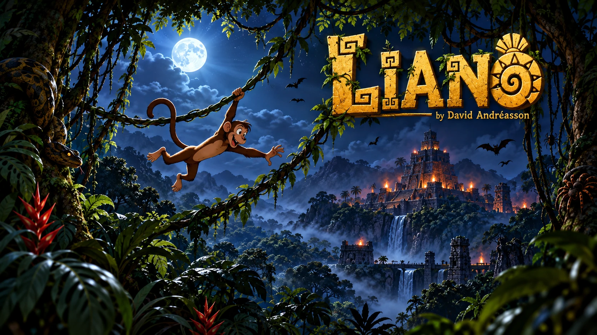

# Liano



A one-button browser game. A monkey swings on lianas through the jungle; let go to fly to the next one.

Play it at **https://skogdoom.github.io/liano/**.

## How it plays

- The monkey swings on a liana. Press **Space**, or tap/click, to let go.
- It flies in the direction of the swing and grabs the next liana it touches. Letting go on the backswing sends it backwards.
- Obstacles hang above or stand below each gap: fly under or over them. Branches, thorn bushes, rocks and beehives stay put; spiders, snakes, birds and (at night) bats move. Now and then a Mayan temple rises out of the undergrowth.
- Hitting an obstacle or falling off the bottom ends the run.
- Reaching the liana past an obstacle scores a point. Your best score lasts until you reload.
- Bananas are optional: the results show how many you took out of how many you passed. They change nothing else.
- The jungle gets harder as you go, and the time of day moves on from day through dusk to night and dawn, for as long as you last.
- Every gap can be passed: each one leaves a release window of at least 90 ms at first, and at least 40 ms in the latest stages.
- By default the monkey holds the vine where it caught it. Wait too long and it lets go by itself, tired. With slipping on (**G**) the grip slides down the vine instead, and the end of the vine blinks before the monkey is forced off.

## Two players

Press **1**, **2** or **3** on the title screen for one player, two players on a shared screen, or split screen. Player 1 lets go with **A**, player 2 with **L**. Each has 3 lives, and when both are out the higher score wins. On the shared screen each monkey swings on its own vines (green and golden) and the view follows whoever is ahead; fall too far behind and you drop off the left edge. The two-player modes need a keyboard.

## Keys

- **Space**, a click or a tap lets go (**A** and **L** with two players).
- **P** pauses, **Esc** goes back to the title screen.
- **M** mutes the sound, **F** (or the button next to the speaker) toggles full screen.
- **G** turns the slipping grip on and off, anywhere.
- **H** turns lives on for one player (on the title screen): you get 3, and every fifth banana you take turns the next banana into a heart that gives one more.
- **S** turns the shadow monkey on (on the title screen, one player): your best earlier game is replayed as a grey, see-through monkey beside you, on the same jungle every game until you reload.
- **D** shows the debug view: hitboxes, the predicted flight, the release window and the frame rate.
- **C** opens Config on the title screen. Choose classic or cartoon graphics and the rendering quality there; **X** switches the graphics choice while Config is open.

**H** and **S** are for the desktop. Graphics and quality choices persist; changing either in Config reloads the game while preserving the current match options. Phones and iPads play one player in either orientation. iPhone Safari has no full screen for web pages: add the game to the Home Screen to play it without the browser bars.

## Technology

JavaScript (ES modules), [Phaser](https://phaser.io/) 4.2.1 for rendering, scenes, input and sound, [Vite](https://vite.dev/) for dev and build, [Vitest](https://vitest.dev/) for unit tests, and [Playwright](https://playwright.dev/) for browser checks. A fixed-step simulation drives rigs assembled from texture-atlas pieces. Classic art is generated from SVG; the default cartoon pack combines painted masters and vector recipes. The build creates independent packs at 1×, 2× and 4×, and the game downloads only the selected pack and scale. Sounds are synthesized with the Web Audio API through Phaser's audio context. There is no backend.

## Custom art

Replace individual pieces with PNG or SVG files and rebuild the atlases. See the [art guide](art/README.md) for piece names, dimensions, origins and exports, and the [cartoon authoring guide](art/packs/cartoon/README.md) for painted sources and recipes. Config selects between the complete classic and cartoon packs; both use the same gameplay and sounds.

## Running it

Needs Node.js 22.12 or newer.

```sh
npm install
npm run dev        # play at the printed local address
npm run dev:host   # same, reachable from a phone on your network
npm test           # run the tests
npm run build      # production build in dist/
npm run preview    # serve that build at /liano/, as on GitHub Pages
```

Every pull request is tested and built by GitHub Actions, and every push to `master` is published to GitHub Pages.

For the M8a artwork review, run `npm run dev` and open `/art-review.html` at the printed local address (for example, `http://localhost:5173/art-review.html`). Use `npm run dev:host` to review on a phone over your network. This development page includes image zoom, motion clips and downloadable review notes; it is not included in the production build.

The plan, its status and roadmap are in [PLAN.md](PLAN.md), with the detail by area under [docs/plans/](docs/plans/).

After changing a tunable in `src/config.js`, run `npm run windows` to rebuild the table of release windows (the build does this too).

## Disclaimer

Mostly vibe coded: most of the code was written by an AI assistant. It is provided as is, and you run it at your own risk. See [LICENSE](LICENSE) (MIT).
